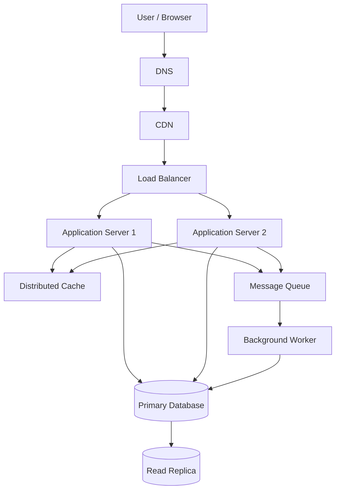

# QuickNotes System Architecture

## 1. Functional requirements

- Users can register, log in and log out securely.
- Users can create, view, update and delete their own notes.
- Users can create tags and attach them to notes.
- Users can search, sort and paginate through their notes.
- The service returns meaningful errors for invalid requests.
- Users cannot access another user's private notes.

## 2. Non-functional requirements

- Availability target: 99.9% monthly.
- Performance target: p95 note-list response below 300 ms under
  normal load, excluding unusually slow client networks.
- Security: HTTPS, password hashing, authenticated requests,
  authorization checks, rate limiting and secure secret storage.
- Scalability: add application instances when demand increases.
- Reliability: health checks, backups, monitoring and recovery tests.
- Maintainability: modular services, automated tests and structured logs.
- Data integrity: database constraints and transactional writes.

These are proposed engineering targets, not claims of current performance.

## 3. Load estimates for one million registered users

### Assumptions

- 1,000,000 registered users.
- 10% are active on an average day: 100,000 daily active users.
- Each active user makes 50 note-read requests per day.
- Each active user creates one note per day.
- Average stored note size, including metadata, is 1 KB.
- A year has 365 days.
- Peak traffic is estimated at five times average traffic.
- Traffic is averaged over 24 hours for these calculations.

### Reads per second

100,000 users × 50 reads = 5,000,000 reads/day.

5,000,000 / 86,400 = approximately 58 reads/second on average.

Estimated peak: 58 × 5 = approximately 290 reads/second.

### Writes per second

100,000 users × 1 note = 100,000 new notes/day.

100,000 / 86,400 = approximately 1.16 writes/second on average.

Estimated peak: 1.16 × 5 = approximately 5.8 writes/second.

This estimate counts note creations only; updates, deletes, logins and
tag operations would add further traffic.

### Storage per year

100,000 notes/day × 365 days = 36,500,000 notes/year.

36,500,000 × 1 KB = approximately 36.5 GB of raw note data/year,
using decimal units and excluding database overhead.

A rough planning allowance of 2× for indexes and related storage gives
approximately 73 GB/year before replication, backups and logs.

The database team must measure actual note sizes and growth before
finalizing storage capacity.

## 4. Architecture diagram

## 5. What each component solves

- Client/browser: provides the interface where users manage notes.
- DNS: translates the service domain into the relevant network address.
- CDN: caches static files close to users and reduces origin traffic.
- Load balancer: distributes requests across healthy application servers.
- Application server 1: validates requests and implements API operations.
- Application server 2: provides additional capacity and redundancy.
- Distributed cache: speeds up frequently accessed data and reduces
  repeated database reads; cache misses go to the database.
- Primary database: stores authoritative records and handles writes.
- Read replica: serves eligible read queries and reduces primary load.
- Message queue: buffers asynchronous work and separates it from
  the user's immediate request.
- Background worker: processes queued work such as notifications,
  exports and other non-urgent tasks.

## 6. GET /notes request flow

1. The browser sends GET /v1/notes with an access token.
2. DNS resolves the service domain, and the CDN forwards dynamic API
   requests to the origin rather than serving private notes as public
   cached content.
3. The load balancer routes the request to a healthy application server.
4. The application validates the token and confirms the user's identity.
5. The application checks the cache for a suitable user-scoped result.
6. On a cache miss, the application queries the read replica when
   appropriate, or the primary when strong read-after-write consistency
   is required.
7. The application returns the notes as JSON with pagination metadata.
8. Eligible cached results are stored with a suitable expiry policy.

## 7. POST /notes request flow

1. The browser sends POST /v1/notes with a valid access token and JSON.
2. The load balancer routes the request to a healthy application server.
3. The application authenticates the user and validates the title
   and body.
4. The application writes the note to the primary database in a
   transaction, associating it with the authenticated user's ID.
5. The database commits the transaction and returns the new note ID.
6. The application invalidates or updates affected cache entries.
7. The application responds with 201 Created and the new note.
8. Any optional asynchronous work is placed on the message queue
   for a worker to process.

The API should acknowledge creation only after the primary database
confirms the write. Cache invalidation and queued work need retry
strategies so temporary failures do not silently lose updates.

## 8. Trade-offs

### Trade-off A: Cache speed versus data freshness

Caching reduces database reads and improves latency, but cached notes
can become stale. Use short expiry times, user-scoped cache keys and
invalidation after writes. Read directly from the primary when immediate
read-after-write consistency is necessary.

### Trade-off B: Read replica versus consistency

A read replica distributes read load but may lag behind the primary.
Use the primary for reads that must immediately reflect a recent write,
and use the replica for reads that can tolerate brief delays.

### Trade-off C: Synchronous versus asynchronous work

Synchronous work gives immediate results but increases request time.
Queues let the API return sooner for optional tasks, but introduce
delivery delays, retries, duplicate processing risks and operational
complexity. Workers should be idempotent where possible.

### Trade-off D: More servers versus operating cost

Multiple instances increase capacity and resilience but cost more and
require monitoring and deployment coordination. Scale based on observed
traffic and resource usage rather than assuming more servers always
improve performance.

## 9. Avoiding single points of failure

- Run at least two application servers across separate failure domains.
- Deploy redundant load-balancer instances or use a managed service
  with a highly available configuration.
- Use highly available DNS and CDN providers.
- Deploy the database with automated failover, backups and tested recovery.
- Monitor replication lag and define a recovery point and recovery time.
  A replica alone is not a complete backup strategy.
- Use a durable, replicated queue and retry failed background jobs.
- Make cache loss survivable: the application must be able to fall back
  to the database when safe.
- Add health checks, alerts, rate limits and tested disaster-recovery
  procedures.

## 10. Conclusion

The proposed architecture separates the browser, application,
database and asynchronous work so that each layer can scale independently.
Start with a reliable relational database and two application instances,
then use measurements to guide caching, replication and capacity growth.
